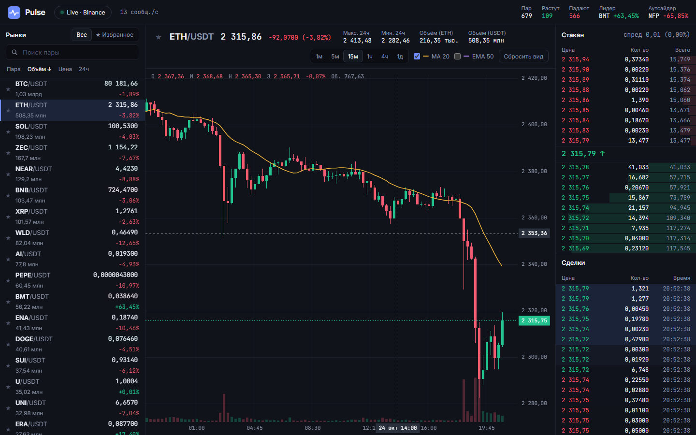

# Pulse

[](https://github.com/Qwertyzxas/pulse/actions/workflows/ci.yml)

Крипто-дашборд в реальном времени: живые котировки сотен пар Binance, собственный свечной график на Canvas, стакан и лента сделок. Сеть и разбор данных вынесены в Web Worker.

**[▶ Открыть](https://qwertyzxas.github.io/pulse/)** · **[демо-режим без сети](https://qwertyzxas.github.io/pulse/?demo)**



## Возможности

- **Рынки.** Все активные USDT-пары Binance (~680) с обновлением каждую секунду: поиск, сортировка, избранное, вспышки при изменении цены. Список виртуализирован: в DOM только видимые строки.
- **Свечной график без библиотек** на Canvas 2D: зум колесом вокруг курсора, перетаскивание, перекрестие с OHLC-легендой, объёмы, MA 20 и EMA 50, интервалы от 1 минуты до 1 дня. Управляется и с клавиатуры: `←` `→` — сдвиг, `+` `−` — масштаб, `Home` — сброс.
- **Стакан**: 15 лучших уровней с каждой стороны, накопленный объём и спред.
- **Лента сделок** в реальном времени.
- **Надёжное подключение.** Переподключение с экспоненциальной задержкой, сторожевой таймер для «молча умерших» сокетов, при недоступности биржи — автоматический переход на демо-данные с объяснением причины и кнопкой повторной попытки.
- **Ссылки на состояние**: `?s=ETHUSDT&i=4h` открывает нужную пару и интервал.

## Архитектура

```
 ┌──────────────── Web Worker ────────────────┐        ┌──────── UI thread (Vue) ────────┐
 │  BinanceFeed ─┐                            │        │                                 │
 │   (REST + WS) ├─► FeedController ─► Batcher ├─ 5/с ─►│ market store ─► компоненты      │
 │  SimulatedFeed┘   fallback, поколения      │        │ (shallowRef)    ChartEngine     │
 └────────────────────────────────────────────┘        └─────────────────────────────────┘
```

```
src/
  core/        чистые функции: форматирование, свечи, индикаторы, рынки, стакан, бэкофф, виртуализация
  chart/       scale.ts — математика осей и вьюпорта, ChartEngine.ts — отрисовка на Canvas
  feed/        источники данных, контроллер и пакетировщик (работают в Web Worker)
  state/       реактивное состояние рынка для Vue
  components/  интерфейс
```

### Ключевые решения

- **Web Worker для данных.** Сокет, `JSON.parse` и сотни обновлений в секунду не нагружают поток интерфейса. Воркер объединяет события и отправляет в UI не больше пяти сообщений в секунду: последнюю версию каждого тикера, последний стакан, последнюю свечу и не больше 50 сделок.
- **Один интерфейс для двух источников.** `BinanceFeed` и `SimulatedFeed` реализуют общий `FeedSource`. Симулятор с seed-генератором (геометрическое броуновское движение) даёт воспроизводимые данные для демо, офлайн-показа и e2e-тестов.
- **«Поколения» источников.** У каждого запущенного источника есть номер. Запоздалые ответы старого источника (fetch в полёте, кадр сокета) после переключения просто игнорируются, а не портят состояние.
- **Подписки без переподключения.** При смене пары воркер шлёт в открытый сокет `UNSUBSCRIBE`/`SUBSCRIBE`, а не пересоздаёт соединение.
- **График отделён от отрисовки.** Вся математика (вьюпорт, зум вокруг курсора, «красивые» деления осей, подписи времени) — чистые функции в `scale.ts` с тестами. `ChartEngine` перерисовывает только «грязные» кадры через `requestAnimationFrame` и учитывает `devicePixelRatio`.
- **`shallowRef` для больших коллекций.** Тикеры, свечи и стакан заменяются целиком раз в пакет, глубокая реактивность Vue здесь только добавила бы накладные расходы.
- **Зависимости через конструктор.** `fetch`, `WebSocket` и таймеры передаются в `BinanceFeed` снаружи, поэтому переподключение, сторожевой таймер и откат на демо проверяются юнит-тестами с фейковым сокетом и фейковым временем.

## Тесты

| Уровень | Инструмент | Что проверяется |
| --- | --- | --- |
| Юнит | Vitest | форматирование, свечи, индикаторы, сортировка рынков, стакан, математика графика, парсеры Binance на реальных ответах биржи, переподключение и откат на демо, детерминизм симулятора, пакетирование |
| Компоненты | Vue Test Utils | список рынков (сортировка, поиск, избранное, стрелки), шапка пары, статус подключения, стакан |
| E2E | Playwright | отрисовка графика, перекрестие и зум, смена пары и интервала с сохранением в URL, клавиатура |
| Доступность | axe-core | нет серьёзных нарушений WCAG 2 AA |

```bash
npm test                      # юнит и компонентные тесты
npm run e2e                   # e2e на симуляторе
LIVE=1 npx playwright test live   # e2e против настоящего Binance
```

## Запуск

```bash
npm install
npm run dev       # http://127.0.0.1:5175/pulse/
npm run build
```

Данные — публичные эндпоинты Binance для рыночной информации (`data-api.binance.vision`, `data-stream.binance.vision`), ключи API не нужны. Проект не является торговым инструментом.

## Стек

TypeScript (strict) · Vue 3 · Vite · Canvas 2D · Web Workers · WebSocket · Vitest · Vue Test Utils · Playwright · axe-core

## Лицензия

MIT
